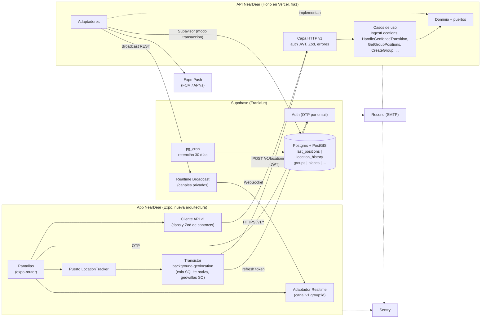

# NearDear — Plan hasta el MVP y hoja de ruta

> Estado: **borrador para revisión**. No se implementa nada hasta que se apruebe explícitamente.
> Repositorio: `neardear` (público; antes `free-360`). Nombre del producto: **NearDear** (de *"nearest and dearest"*; pendiente de verificar en TMview, tiendas y dominios).

## Índice

1. [Resumen y decisiones tomadas](#1-resumen-y-decisiones-tomadas)
2. [Ajustes respecto al planteamiento inicial](#2-ajustes-respecto-al-planteamiento-inicial)
3. [Arquitectura](#3-arquitectura)
4. [Estructura del monorepo](#4-estructura-del-monorepo)
5. [Modelo de datos inicial](#5-modelo-de-datos-inicial)
6. [Contrato de la API v1](#6-contrato-de-la-api-v1)
7. [MapLibre frente a Mapbox](#7-maplibre-frente-a-mapbox)
8. [Seguridad y privacidad](#8-seguridad-y-privacidad)
9. [Cómo se trabaja cada fase](#9-cómo-se-trabaja-cada-fase)
10. [Hito 0 — Fundamentos y prueba de concepto](#10-hito-0--fundamentos-y-prueba-de-concepto)
11. [Hito 1 — Exploración (MVP a coste 0 €)](#11-hito-1--exploración-mvp-a-coste-0-)
12. [Hito 2 — Publicación (de pago)](#12-hito-2--publicación-de-pago)
13. [Cómo el MVP deja abierto el escalado](#13-cómo-el-mvp-deja-abierto-el-escalado)
14. [Hoja de ruta posterior al MVP](#14-hoja-de-ruta-posterior-al-mvp)
15. [Decisiones abiertas](#15-decisiones-abiertas)
16. [Estimación de costes](#16-estimación-de-costes)

---

## 1. Resumen y decisiones tomadas

| Tema | Decisión |
|---|---|
| Audiencia | MVP **solo mayores de 18**. Menores con cuenta aprobada por un adulto → después del MVP. |
| Mercado | España primero; diseño preparado para más mercados (i18n, textos legales, región UE). |
| Dispositivos de prueba | iPhone 12, iPhone 13, OnePlus Nord 4. Mac disponible. |
| Autenticación | **Código por email (OTP)** de Supabase Auth, enviado con **Resend** (dominio ya verificado). Sin Google ni Apple. |
| Grupos | Varios grupos por usuario. Roles admin/miembro. Código de invitación de 48 h, regenerable y multiuso. Máx. 10 miembros (configurable). |
| Pausa | **Global**. Los demás ven "En pausa" **sin posición**. En pausa el móvil deja de rastrear. |
| Lugares | Avisos de llegada/salida a **todos los demás** miembros. No se avisa a quien entra o sale. Margen anti-repetición. Sin preferencias en el MVP. |
| Historial | Se guarda desde el primer día, **30 días**, borrado automático diario, plazo configurable. No se muestra en el MVP. |
| Cuentas de tienda | Persona física. Se pagan **solo en el hito de publicación**. |
| Licencia Transistor | No se compra en la exploración. Android se prueba con **builds de debug**. |
| Hitos | **Exploración (0 €)** → **Publicación (de pago)**. |
| Repositorio | **Público**, con guardarraíles de seguridad desde el primer commit. |
| Ritmo | Ratos diarios, implementación mayormente autopilotada; tú revisas y pruebas en dispositivo. |
| Herramientas | pnpm + Turborepo, TypeScript, Vitest (API y paquetes), Jest (app), GitHub Actions, Supabase y Vercel en Frankfurt, Sentry, app en español con i18n, MapLibre + OpenFreeMap. |

---

## 2. Ajustes respecto al planteamiento inicial

Cosas del planteamiento original que matizo, con su justificación:

1. **El contrato v1 tiene más de 3 endpoints.** Grupos, invitaciones, lugares, pausa, borrado y token de push necesitan los suyos. Los tres endpoints iniciales siguen siendo el núcleo. Ver [§6](#6-contrato-de-la-api-v1).
2. **Los eventos de geovalla viajan dentro del lote de `POST /v1/locations`.** Transistor ya adjunta el evento de geovalla al registro de ubicación que lo provoca. No hace falta un endpoint aparte: hay menos peticiones, se gasta menos batería y se reutilizan la cola offline y los reintentos de la librería. El principio nº 5 se mantiene: el móvil detecta y el servidor avisa.
3. **Realtime es la única excepción controlada al principio nº 1.** La app se suscribe directamente a Supabase Realtime, porque una API serverless no puede mantener WebSockets. Para no atarse al proveedor: canal privado autorizado por RLS, nombre y payload versionados (`v1:group:{id}`), payload definido con Zod en `packages/contracts` y un único adaptador en la app.
4. **"Solo con el mapa abierto" necesita saber quién está mirando.** Se añade el puerto `MapViewerRegistry`: la app envía un latido mientras el mapa está visible y la API solo emite a los grupos con espectadores. Hoy usa Postgres y mañana Redis con TTL.
5. **Renovación del token en segundo plano.** Transistor envía los lotes desde código nativo, aunque la parte JS esté muerta. El JWT de Supabase caduca en 1 h, así que se usa la renovación integrada de Transistor (`authorization.refreshUrl`) y se sincronizan los tokens con `supabase-js` para que no se invaliden entre sí al rotar el refresh token. Se valida en la Fase 0.
6. **Pooler de conexiones desde el MVP.** Las funciones serverless abren muchas conexiones. La API usa Supavisor en modo transacción desde el primer día, no a partir de 5.000 usuarios.
7. **Ningún cliente lee tablas directamente.** El principio dice "tablas de localización", pero lo extiendo a **todas**: la app solo habla con la API. RLS activado en todas las tablas y sin políticas para `anon`/`authenticated`, de modo que se deniega todo por defecto. La única política es la de autorización de canales Realtime. Así el contrato es uno solo y la defensa en profundidad es total.
8. **Lotes en pausa: se aceptan y se descartan.** Transistor reintenta mientras no reciba un 2xx. Si la API respondiera con error a los lotes que llegan después de pausar, el móvil los reintentaría sin fin. Responde `200` con `discarded`.
9. **El nombre.** Se descartó "NearDear" por su parecido con Life360, marca registrada del mismo sector. El nombre elegido es **NearDear**. Antes de publicar hay que verificar en TMview (EUIPO), en las tiendas y en los registros de dominios que está libre. Es una tarea de la fase P1, aunque conviene hacerla cuanto antes.
10. **El revisor de Apple no puede recibir tu código OTP.** Para la revisión hace falta una cuenta de demo con un código fijo, activable solo para un email concreto. Está en la fase P5.

---

## 3. Arquitectura



### Puertos del dominio (backend)

| Puerto | Responsabilidad | Adaptador MVP | Adaptador futuro |
|---|---|---|---|
| `LastPositionStore` | Leer y actualizar la última posición de cada usuario (solo si es más reciente). | Postgres (`last_positions`) | Upstash Redis (`GEOADD` + hash) |
| `LocationHistory` | Añadir posiciones al historial. | Inserción directa en Postgres | Cola (Redis Streams / QStash) + consumidor |
| `GroupNotifier` | Avisar en tiempo real a un grupo (posición, pausa, evento de lugar). | Supabase Realtime Broadcast (REST) | El mismo u otro proveedor |
| `MapViewerRegistry` | Saber qué grupos tienen el mapa abierto. | Postgres con caducidad | Redis con TTL |
| `PushSender` | Enviar notificaciones push. | Expo Push API | Igual, o FCM/APNs directo |
| `GroupMembership` | Grupos de un usuario, roles y miembros. | Postgres | — |
| `PlaceRepository` | Lugares de un grupo y su versión. | Postgres | — |
| `GeofenceEventLog` | Registrar eventos de lugar y consultar el margen anti-repetición. | Postgres | — |
| `PushTokenRepository` | Tokens de push por usuario. | Postgres | — |
| `UserAccountRepository` | Perfil, consentimiento, pausa, borrado. | Postgres + Supabase Admin API | — |
| `RemoteConfigProvider` | Configuración remota. | Tabla `remote_config` | Igual, o un servicio de flags |
| `Clock`, `IdGenerator` | Tiempo e identificadores, para tests deterministas. | Sistema | — |

### Caso de uso central: `IngestLocations`

Entrada: `userId` autenticado y un lote validado.

1. Si el usuario tiene la compartición en pausa, se descarta el lote entero (`accepted: 0, discarded: n`).
2. Se filtran las posiciones inválidas por reglas de dominio: coordenadas fuera de rango, fecha en el futuro (más de 5 min) o precisión peor que el umbral de la configuración. Las descartadas se cuentan.
3. Se ordenan por `recordedAt` y se eliminan los duplicados dentro del lote.
4. `LocationHistory.append(posiciones)`, idempotente por `(user_id, recorded_at)`.
5. `LastPositionStore.upsertIfNewer(más reciente)`. Si llegan lotes desordenados no se retrocede.
6. Si la última posición cambió: `MapViewerRegistry.groupsWithViewers(gruposDelUsuario)` → `GroupNotifier.positionChanged(...)`.
7. Para cada registro con evento de geovalla → `HandleGeofenceTransition`.
8. Devuelve `{ accepted, discarded }`.

### Caso de uso `HandleGeofenceTransition`

1. Comprueba que el lugar existe y que el usuario es miembro de su grupo. Si no, lo descarta: el móvil puede tener geovallas antiguas.
2. Idempotencia: el mismo `(placeId, userId, action, occurredAt)` no se procesa dos veces.
3. Margen anti-repetición: si hubo un evento igual en los últimos `geofenceCooldownMinutes`, lo registra pero no avisa.
4. Registra el evento, avisa por `GroupNotifier` (para quien tenga la app abierta, incluido iOS sin push) y envía push con `PushSender` a **los demás** miembros.

---

## 4. Estructura del monorepo

```
neardear/
├─ apps/
│  ├─ mobile/                    # App Expo (NearDear)
│  │  ├─ app/                    # Rutas expo-router
│  │  ├─ src/
│  │  │  ├─ features/            # auth, onboarding, groups, map, places, sharing, account
│  │  │  ├─ location/            # Puerto LocationTracker + adaptador Transistor
│  │  │  ├─ api/                 # Cliente tipado de la API v1
│  │  │  ├─ realtime/            # Adaptador Realtime (canal v1)
│  │  │  ├─ i18n/                # Textos (es)
│  │  │  └─ shared/
│  │  ├─ test/
│  │  └─ app.config.ts
│  ├─ api/                       # API Hono (Vercel)
│  │  ├─ src/
│  │  │  ├─ domain/              # Entidades, value objects, puertos, errores de dominio
│  │  │  ├─ application/         # Casos de uso
│  │  │  ├─ infrastructure/      # Adaptadores: postgres, supabase-realtime, expo-push, ...
│  │  │  ├─ http/                # Rutas /v1, middlewares, mapeo de errores
│  │  │  └─ main/                # Composition root y punto de entrada de Vercel
│  │  └─ test/
│  │     ├─ unit/                # Dominio y casos de uso (adaptadores en memoria)
│  │     ├─ integration/         # Adaptadores contra Supabase local
│  │     └─ http/                # Rutas con app.request() de Hono
│  └─ poc/                       # Solo Hito 0: app y receptor PoC (se archiva al terminar)
├─ packages/
│  ├─ contracts/                 # Esquemas Zod y tipos de la API v1 y del canal Realtime
│  ├─ test-fixtures/             # Datos ficticios (coordenadas y emails inventados)
│  └─ config/                    # tsconfig, eslint y prettier compartidos
├─ supabase/
│  ├─ migrations/                # SQL versionado
│  ├─ seed.sql                   # Datos ficticios para local
│  └─ config.toml
├─ scripts/
│  ├─ check-rls.ts               # Falla si alguna tabla no tiene RLS
│  └─ check-forbidden-secrets.ts # Falla si service_role aparece fuera de apps/api
├─ docs/
│  ├─ plan.md
│  ├─ adr/                       # Decisiones de arquitectura
│  ├─ poc/                       # Informe de la Fase 0
│  └─ legal/                     # Política de privacidad, registro de tratamiento
├─ .github/workflows/            # CI
├─ CLAUDE.md                     # Reglas para el agente
├─ SECURITY.md
├─ lefthook.yml
├─ turbo.json
└─ pnpm-workspace.yaml
```

Las dependencias solo van en un sentido: `domain` no importa nada de fuera; `application` importa `domain`; `infrastructure` y `http` importan ambas; `main` lo conecta todo. Una regla de ESLint (`import/no-restricted-paths`) lo hace cumplir en la CI.

---

## 5. Modelo de datos inicial

Todo en el esquema `public` con RLS activado y **sin políticas para `anon`/`authenticated`**. La API accede con un rol propio, `neardear_api`, a través del pooler.

```sql
-- Extensiones
create extension if not exists postgis;
create extension if not exists pg_cron;

-- Perfiles (1:1 con auth.users)
create table profiles (
  user_id          uuid primary key references auth.users(id) on delete cascade,
  display_name     text not null check (char_length(display_name) between 1 and 40),
  consent_version  text,                 -- versión del texto de consentimiento aceptado
  consent_at       timestamptz,
  sharing_paused   boolean not null default false,
  paused_at        timestamptz,
  created_at       timestamptz not null default now()
);

-- Grupos
create table groups (
  id              uuid primary key default gen_random_uuid(),
  name            text not null check (char_length(name) between 1 and 40),
  created_by      uuid not null references profiles(user_id),
  places_version  integer not null default 0,   -- sube con cada cambio de lugares
  created_at      timestamptz not null default now()
);

create type group_role as enum ('admin', 'member');

create table group_members (
  group_id   uuid not null references groups(id) on delete cascade,
  user_id    uuid not null references profiles(user_id) on delete cascade,
  role       group_role not null default 'member',
  joined_at  timestamptz not null default now(),
  primary key (group_id, user_id)
);
create index group_members_user_idx on group_members (user_id);

-- Invitaciones (un código activo por grupo)
create table group_invites (
  code        text primary key,                 -- 8 caracteres sin ambiguos (sin 0/O, 1/I)
  group_id    uuid not null references groups(id) on delete cascade,
  created_by  uuid not null references profiles(user_id) on delete cascade,
  expires_at  timestamptz not null,
  revoked_at  timestamptz,
  created_at  timestamptz not null default now()
);
create index group_invites_group_idx on group_invites (group_id);

-- Última posición (1 fila por usuario)
create table last_positions (
  user_id      uuid primary key references profiles(user_id) on delete cascade,
  geog         geography(Point, 4326) not null,
  accuracy_m   real not null,
  speed_mps    real,
  heading_deg  real,
  is_moving    boolean,
  recorded_at  timestamptz not null,
  received_at  timestamptz not null default now()
);
create index last_positions_geog_idx on last_positions using gist (geog);

-- Historial (preparado para particionar por fecha)
create table location_history (
  user_id      uuid not null references profiles(user_id) on delete cascade,
  recorded_at  timestamptz not null,
  geog         geography(Point, 4326) not null,
  accuracy_m   real not null,
  speed_mps    real,
  heading_deg  real,
  is_moving    boolean,
  activity     text,                 -- still, walking, in_vehicle, ...
  battery      real,                 -- se guarda ya; se mostrará después del MVP
  client_uuid  uuid,                 -- uuid del registro en Transistor
  received_at  timestamptz not null default now(),
  primary key (user_id, recorded_at) -- incluye la clave de partición futura
);
create index location_history_recorded_brin on location_history using brin (recorded_at);

-- Lugares
create table places (
  id          uuid primary key default gen_random_uuid(),
  group_id    uuid not null references groups(id) on delete cascade,
  name        text not null check (char_length(name) between 1 and 40),
  center      geography(Point, 4326) not null,
  radius_m    integer not null check (radius_m between 100 and 1000),
  created_by  uuid references profiles(user_id) on delete set null,
  created_at  timestamptz not null default now(),
  updated_at  timestamptz not null default now()
);
create index places_group_idx on places (group_id);
create index places_center_idx on places using gist (center);

-- Eventos de lugar
create type geofence_action as enum ('enter', 'exit');

create table geofence_events (
  id           bigint generated always as identity primary key,
  place_id     uuid not null references places(id) on delete cascade,
  user_id      uuid not null references profiles(user_id) on delete cascade,
  action       geofence_action not null,
  occurred_at  timestamptz not null,
  received_at  timestamptz not null default now(),
  notified     boolean not null default false,
  unique (place_id, user_id, action, occurred_at)
);
create index geofence_events_cooldown_idx on geofence_events (place_id, user_id, action, occurred_at desc);

-- Tokens de push
create table push_tokens (
  token       text primary key,
  user_id     uuid not null references profiles(user_id) on delete cascade,
  platform    text not null check (platform in ('ios', 'android')),
  updated_at  timestamptz not null default now()
);
create index push_tokens_user_idx on push_tokens (user_id);

-- Quién tiene el mapa abierto
create table map_viewers (
  group_id    uuid not null references groups(id) on delete cascade,
  user_id     uuid not null references profiles(user_id) on delete cascade,
  expires_at  timestamptz not null,
  primary key (group_id, user_id)
);
create index map_viewers_expires_idx on map_viewers (group_id, expires_at);

-- Configuración remota
create table remote_config (
  key    text primary key,
  value  jsonb not null,
  updated_at timestamptz not null default now()
);
```

### Seguridad a nivel de fila (RLS)

```sql
-- En TODAS las tablas de public:
alter table <tabla> enable row level security;
alter table <tabla> force row level security;
-- Y ninguna política para anon/authenticated → denegado por defecto.

-- El rol de la API tiene sus propios permisos y BYPASSRLS (no es service_role).
-- La autorización (¿es miembro?, ¿es admin?) vive en el dominio y está cubierta por tests.

-- Única política para clientes: autorización de canales Realtime privados.
create policy "miembros leen su canal de grupo"
on realtime.messages for select to authenticated
using (
  realtime.topic() like 'v1:group:%'
  and exists (
    select 1 from public.group_members m
    where m.user_id = auth.uid()
      and 'v1:group:' || m.group_id::text = realtime.topic()
  )
);
```

### Retención

```sql
-- Diario a las 03:17 (Europe/Madrid ≈ UTC+1/+2)
select cron.schedule('retencion-historial', '17 2 * * *', $$
  delete from location_history
  where recorded_at < now() - make_interval(days => (
    select (value->>'days')::int from remote_config where key = 'historyRetention'
  ));
  delete from geofence_events where occurred_at < now() - interval '30 days';
  delete from map_viewers where expires_at < now();
$$);
```

Cuando el volumen lo pida, el borrado pasa a ser un `DROP` de la partición diaria (ver [§13](#13-cómo-el-mvp-deja-abierto-el-escalado)).

---

## 6. Contrato de la API v1

**Convenciones**

- Base: `https://api.<dominio>/v1`. Solo HTTPS.
- Autenticación: `Authorization: Bearer <JWT de Supabase>` en todo salvo `/v1/health` y `/v1/auth/refresh`.
- Cabecera `X-App-Version` en todas las peticiones. Si es inferior a `minAppVersion`, la respuesta es `426`.
- Todos los cuerpos se validan con los esquemas Zod de `packages/contracts`, que comparten app y API.
- Fechas en ISO 8601 UTC. Coordenadas en WGS84.
- Se versiona solo cuando un cambio **rompe** el contrato. Los campos nuevos opcionales se quedan en v1.

**Formato de error** (igual en todos los endpoints):

```json
{ "error": { "code": "GROUP_FULL", "message": "El grupo ha alcanzado el máximo de miembros", "details": {} } }
```

| HTTP | `code` | Cuándo |
|---|---|---|
| 400 | `VALIDATION_ERROR` | El cuerpo o los parámetros no cumplen el esquema (`details` lista los campos). |
| 401 | `UNAUTHENTICATED` | Falta el token o no es válido. |
| 403 | `FORBIDDEN` | No eres miembro del grupo o no eres admin. |
| 403 | `CONSENT_REQUIRED` | No has aceptado el consentimiento vigente. |
| 404 | `NOT_FOUND` | El recurso no existe o no tienes acceso (no se distingue a propósito). |
| 409 | `GROUP_FULL` | El grupo ha llegado al máximo de miembros. |
| 409 | `ALREADY_MEMBER` | Ya perteneces al grupo. |
| 409 | `LAST_ADMIN` | No puedes salir: eres el único admin y hay más miembros. |
| 410 | `INVITE_EXPIRED` | El código ha caducado o se ha revocado. |
| 413 | `BATCH_TOO_LARGE` | El lote supera `maxBatchSize`. |
| 426 | `UPGRADE_REQUIRED` | La versión de la app ya no está soportada. |
| 429 | `RATE_LIMITED` | Reservado para cuando haya límite de peticiones. |
| 500 | `INTERNAL` | Error inesperado (con id de Sentry en `details.eventId`). |

### Endpoints

| Método y ruta | Descripción |
|---|---|
| `GET /v1/health` | Comprobación de vida (sin auth). |
| `POST /v1/auth/refresh` | `{ "refreshToken": "…" }` → nuevo token y token de renovación. Sin JWT (lo usa Transistor cuando el token ha caducado). Hoy delega en Supabase Auth. |
| `GET /v1/config` | Configuración remota. |
| `GET /v1/me` | Perfil, estado de pausa y consentimiento. |
| `PATCH /v1/me` | Cambiar `displayName` o aceptar el consentimiento (`consentVersion`). |
| `PUT /v1/me/sharing` | `{ "paused": true \| false }` |
| `PUT /v1/me/push-token` | `{ "token": "ExponentPushToken[...]", "platform": "android" }` |
| `DELETE /v1/me` | Borra la cuenta y todos sus datos. `204`. |
| `GET /v1/me/geofences` | Lugares de todos tus grupos para registrar en el SO, con `version`. |
| `POST /v1/groups` | `{ "name": "Familia" }` → grupo + código de invitación. |
| `GET /v1/groups` | Tus grupos. |
| `GET /v1/groups/:id` | Detalle con sus miembros y roles. |
| `POST /v1/groups/:id/invites` | (admin) Regenera el código. Revoca el anterior. |
| `POST /v1/invites/:code/accept` | Unirse al grupo. |
| `DELETE /v1/groups/:id/members/:userId` | Salir (si eres tú) o expulsar (si eres admin). |
| `GET /v1/groups/:id/positions` | Última posición de cada miembro. |
| `PUT /v1/groups/:id/viewers/me` | Latido de "tengo el mapa abierto" (cada 60 s, caduca a los 90 s). |
| `GET /v1/groups/:id/places` | Lugares del grupo. |
| `POST /v1/groups/:id/places` | (admin) Crear un lugar. |
| `PATCH /v1/groups/:id/places/:placeId` | (admin) Renombrar o mover un lugar. |
| `DELETE /v1/groups/:id/places/:placeId` | (admin) Borrar un lugar. |
| `POST /v1/locations` | Lote de posiciones (con eventos de lugar incluidos). |

### `POST /v1/locations`

Acepta el formato JSON nativo de Transistor (`httpRootProperty: "locations"`, `batchSync: true`), validado con un esquema Zod que solo admite el subconjunto de campos que usamos. Lo que sobra se descarta. La traducción al modelo de dominio se hace en la capa HTTP. Así la app no transforma nada, y si se cambia de librería el adaptador de entrada absorbe el cambio.

```json
{
  "locations": [
    {
      "uuid": "0f8f7c2e-6a63-4c1e-9b5a-1d2f3e4a5b6c",
      "timestamp": "2026-11-21T08:15:30.000Z",
      "is_moving": true,
      "coords": { "latitude": 40.4168, "longitude": -3.7038, "accuracy": 12.0, "speed": 1.4, "heading": 90.0 },
      "activity": { "type": "walking" },
      "battery": { "level": 0.82, "is_charging": false },
      "geofence": { "identifier": "place:5b1e…", "action": "ENTER" }
    }
  ]
}
```

Respuesta `200`:

```json
{ "accepted": 9, "discarded": 1, "placesVersion": 4 }
```

`placesVersion` permite que el móvil detecte que hay lugares nuevos sin hacer peticiones extra y que entonces llame a `GET /v1/me/geofences`.

### `GET /v1/groups/:id/positions`

```json
{
  "members": [
    {
      "userId": "…",
      "displayName": "Ana",
      "status": "sharing",
      "position": { "lat": 40.4168, "lng": -3.7038, "accuracyM": 12, "recordedAt": "2026-11-21T08:15:30Z", "isMoving": true }
    },
    { "userId": "…", "displayName": "Luis", "status": "paused", "position": null },
    { "userId": "…", "displayName": "Marta", "status": "no_data", "position": null }
  ]
}
```

### `GET /v1/config`

```json
{
  "minAppVersion": "0.1.0",
  "location": {
    "desiredAccuracy": "high",
    "distanceFilterM": 50,
    "stationaryRadiusM": 25,
    "stopTimeoutMin": 5,
    "autoSyncThreshold": 5,
    "maxBatchSize": 100,
    "heartbeatIntervalSec": 900,
    "maxAccuracyM": 200
  },
  "geofence": { "cooldownMinutes": 10, "minRadiusM": 100, "maxRadiusM": 1000 },
  "groups": { "maxMembers": 10, "inviteTtlHours": 48 },
  "map": { "styleUrl": "https://tiles.openfreemap.org/styles/liberty", "viewerHeartbeatSec": 60 },
  "historyRetentionDays": 30
}
```

Los valores son de partida. Los definitivos salen de la Fase 0.

### Canal Realtime `v1:group:{groupId}` (privado)

Esquemas en `packages/contracts/realtime`:

| Evento | Payload |
|---|---|
| `position` | `{ userId, lat, lng, accuracyM, recordedAt, isMoving }` |
| `sharing` | `{ userId, status: "sharing" \| "paused" }` |
| `place_event` | `{ userId, placeId, placeName, action: "enter" \| "exit", occurredAt }` |
| `members_changed` | `{ }` (la app vuelve a pedir el grupo) |

---

## 7. MapLibre frente a Mapbox

| Criterio | MapLibre (`@maplibre/maplibre-react-native`) | Mapbox (`@rnmapbox/maps`) |
|---|---|---|
| Licencia del SDK | Código abierto (BSD). | SDK propietario, requiere token. |
| Coste | Gratis. Pagas solo las teselas, si eliges un proveedor de pago. | Gratis hasta un umbral de usuarios activos al mes; luego se paga por usuario. |
| Proveedor de teselas | Cualquiera: OpenFreeMap (gratis, sin clave), MapTiler, Stadia, propio. | Mapbox. |
| Calidad visual y extras | Buena. Sin 3D avanzado ni navegación. | Excelente: estilos, 3D, navegación. |
| Expo | Plugin de configuración, requiere development build. | Plugin de configuración, requiere development build. |
| Atadura | Baja: el estilo es una URL que podemos cambiar por configuración remota. | Alta. |
| Privacidad | La única petición sale al proveedor de teselas. | Telemetría de Mapbox (desactivable). |

**Recomendación: MapLibre + OpenFreeMap.** Para este producto basta con un mapa con marcadores y círculos, y no tiene sentido pagar ni atarse a un proveedor. La URL del estilo viene en `GET /v1/config`, así que si OpenFreeMap da problemas (no tiene SLA) se cambia a MapTiler sin publicar la app. **Riesgo a comprobar en F18:** compatibilidad de la versión de MapLibre RN con la nueva arquitectura y la versión de Expo del momento.

---

## 8. Seguridad y privacidad

### Guardarraíles del repositorio público (Fase 0.1)

1. **Pre-commit (lefthook):** `gitleaks protect --staged`. Bloquea claves, tokens y archivos `.env`.
2. **GitHub:** secret scanning con **push protection** activado y **Dependabot** (alertas y PR de seguridad).
3. **CI en cada push y PR:**
   - `gitleaks detect` sobre todo el historial.
   - `scripts/check-rls.ts`: falla si alguna tabla de `public` no tiene RLS activado y forzado.
   - Tests de RLS: un cliente `anon` o `authenticated` no puede leer ni escribir ninguna tabla. Un usuario solo se suscribe a los canales de sus grupos.
   - `scripts/check-forbidden-secrets.ts`: falla si `SUPABASE_SERVICE_ROLE_KEY`, `service_role` o la URL de conexión directa a Postgres aparecen fuera de `apps/api`.
   - `pnpm audit --prod` (aviso, no bloqueo, para no frenar por dependencias de desarrollo).
4. **Datos de prueba:** solo ficticios (`packages/test-fixtures`). Coordenadas inventadas, emails `@example.com`.
5. **`.gitignore`** para `.env*`, `google-services.json` y `GoogleService-Info.plist`, y su ausencia en el repo verificada en la CI.
6. **`CLAUDE.md`** con estas reglas para el agente, y **`SECURITY.md`** con el canal de reporte.

### RGPD (MVP para adultos en España)

| Requisito | Cómo se cumple | Fase |
|---|---|---|
| Base jurídica y consentimiento explícito | Pantalla de consentimiento, versionada y separada de los términos, antes de pedir permisos. Se guardan la versión y la fecha. Sin consentimiento vigente la API responde `CONSENT_REQUIRED`. | F7 |
| Transparencia | Política de privacidad en español: qué se recoge, para qué, plazos, encargados (Supabase, Vercel, Resend, Expo, Sentry, OpenFreeMap) y derechos. | F28 |
| Minimización | Solo los campos necesarios. Sentry sin coordenadas ni emails (filtro `beforeSend`). Los logs no incluyen payloads de ubicación. | F2, F5 |
| Limitación del plazo | Historial de 30 días con borrado diario automático. | F16 |
| Derecho de supresión | Borrar la cuenta desde la app elimina todos los datos al momento (no hay "borrado lógico"). | F27 |
| Derecho de oposición o retirada | Pausa global y revocación de permisos. | F26 |
| Ubicación de los datos | Supabase y Vercel en Frankfurt (UE). | F0.2, F2 |
| Seguridad | TLS en todo, RLS deny-all, rol de API con privilegios mínimos, secretos fuera del repo. | Todas |
| Registro de actividades de tratamiento | Documento en `docs/legal/`. | F28 |
| Evaluación de impacto (EIPD) | Probablemente obligatoria por el seguimiento de ubicación a gran escala. Un borrador antes de publicar. | P1 |

### Requisitos de las tiendas para la ubicación "Siempre"

Se preparan en el hito de publicación, pero los textos se escriben desde F7:

- **iOS:** `NSLocationWhenInUseUsageDescription`, `NSLocationAlwaysAndWhenInUseUsageDescription` y `NSMotionUsageDescription` con textos concretos ("para que los miembros de tus grupos vean dónde estás aunque la app esté cerrada…"). Modo de fondo `location`. Primero se pide "Al usarse" y luego "Siempre", explicando antes por qué. **Vídeo para la revisión** que muestre la función que usa la ubicación en segundo plano, más notas para el revisor y la cuenta de demo.
- **Android:** `ACCESS_FINE_LOCATION`, `ACCESS_BACKGROUND_LOCATION` (se pide aparte, desde Ajustes), `FOREGROUND_SERVICE_LOCATION`, `POST_NOTIFICATIONS` y `ACTIVITY_RECOGNITION`. Pantalla previa obligatoria que explica el uso en segundo plano antes de pedirlo (*prominent disclosure*). En Play Console: **declaración de permisos de ubicación en segundo plano** con vídeo, sección **Seguridad de los datos** y URL de la política de privacidad.
- **OnePlus y otros fabricantes:** pantalla guiada para sacar la app de la optimización de batería (los pasos documentados en *dontkillmyapp.com*).

---

## 9. Cómo se trabaja cada fase

- **Duración:** cada fase cabe en 1–2 días de ratos, y algunas en menos. Las fases "de calendario" (mediciones, prueba familiar) ocupan días reales pero poco trabajo.
- **Autopilotado:** el agente implementa siguiendo TDD (rojo → verde → refactor), con commits pequeños, y abre una PR por fase. Los criterios de aceptación marcados con 🤖 se comprueban de forma automática (tests, comandos). Los marcados con 👤 necesitan tu mano (dispositivo, paseo, revisión visual).
- **Definición de terminado (todas las fases):** CI en verde (lint, tipos, tests, gitleaks, RLS), sin secretos, README o ADR actualizado si hubo una decisión, y demo descrita en la PR.
- **Tests:**
  - *Unitarios (Vitest):* dominio y casos de uso con adaptadores en memoria. **Se escriben primero.**
  - *Integración (Vitest + Supabase local en Docker):* cada adaptador contra Postgres/PostGIS real, y las políticas RLS.
  - *HTTP (Vitest + `app.request()` de Hono):* contrato de cada ruta contra los esquemas de `contracts`.
  - *App (Jest + React Native Testing Library):* lógica de presentación y adaptadores con dobles. E2E con Maestro, después del MVP.

---

## 10. Hito 0 — Fundamentos y prueba de concepto

Objetivo del hito: **validar que la ubicación en segundo plano con Expo + Transistor es fiable y gasta poca batería en tus tres dispositivos**, antes de escribir ninguna funcionalidad.

### F0.1 — Monorepo mínimo y guardarraíles de seguridad

- **Objetivo:** tener un repo público con CI que impida subir secretos desde el primer commit.
- **Alcance:** pnpm workspaces, Turborepo, configuración TS/ESLint/Prettier compartida, `packages/contracts` vacío con un test de ejemplo, CI y guardarraíles. **No entra:** app ni API.
- **Tareas:**
  1. Inicializar pnpm + Turborepo y `packages/config`.
  2. `packages/contracts` con Vitest y un test trivial.
  3. `lefthook.yml` con gitleaks en pre-commit.
  4. Workflow de CI: install, lint, typecheck, test y `gitleaks detect`.
  5. `.gitignore`, `CLAUDE.md`, `SECURITY.md`, `README.md` y licencia (ver decisión abierta D9).
  6. Instrucciones para activar secret scanning, push protection y Dependabot en GitHub (lo haces tú en Ajustes).
- **Tests:** test trivial en `contracts`. Prueba manual de que gitleaks bloquea un commit con una clave falsa.
- **Criterios de aceptación:** 🤖 `pnpm turbo lint typecheck test` en verde en la CI. 🤖 Un commit con `sk_live_…` falso es rechazado por el hook. 👤 Push protection activado en GitHub.
- **Riesgos:** ninguno relevante.
- **Dependencias:** ninguna.

### F0.2 — Receptor PoC

- **Objetivo:** un endpoint desechable que guarde tal cual los lotes que envía Transistor, para medir.
- **Alcance:** proyecto Supabase (Frankfurt, plan gratuito), tabla `poc_batches (id, device_label, received_at, payload jsonb)` con RLS deny-all, y una función en Vercel (`apps/poc/receiver`) protegida con un secreto compartido. **No entra:** auth real ni dominio.
- **Tareas:**
  1. Crear el proyecto Supabase y guardar las credenciales en Vercel (nunca en el repo).
  2. Migración de `poc_batches`.
  3. Función `POST /poc/locations` que valida la cabecera `X-PoC-Key`, guarda el JSON y responde `200`.
  4. Desplegar en Vercel (región `fra1`).
- **Tests:** un test HTTP: sin clave → 401, con clave → 200 y fila insertada (contra Supabase local).
- **Criterios de aceptación:** 🤖 test en verde. 👤 `curl` con un lote de ejemplo aparece en la tabla.
- **Riesgos:** ninguno. Se borra al terminar el hito.
- **Dependencias:** F0.1.

### F0.3 — App PoC con Transistor

- **Objetivo:** una app mínima con development build que rastrea en segundo plano y envía lotes al receptor.
- **Alcance:** Expo (nueva arquitectura), `react-native-background-geolocation` y su plugin de Expo, permisos "Siempre", una pantalla de estado (estado, últimos eventos, botón para registrar una geovalla de prueba en tu casa) y una etiqueta de dispositivo. **No entra:** login, mapa ni diseño.
- **Tareas:**
  1. `apps/poc/mobile` con Expo y development build.
  2. Instalar y configurar Transistor: `stopOnTerminate: false`, `startOnBoot: true`, `batchSync: true`, `autoSyncThreshold: 5`, `distanceFilter: 50`, `url` del receptor, `headers` con la clave PoC, logs de la librería en nivel verbose.
  3. Flujo de permisos: primero "Al usarse", luego "Siempre". En Android, pantalla de explicación previa y acceso a la optimización de batería.
  4. Pantalla de estado y botón "exportar log" (envía el log de Transistor al receptor).
  5. **Prueba de renovación del token:** simular `authorization` JWT con un refresh contra Supabase Auth (usuario de prueba) para validar el patrón del ajuste nº 5.
  6. Compilar e instalar: iOS desde Xcode con tu Apple ID gratuito (en los dos iPhone) y Android en debug en el OnePlus.
- **Tests:** test de Jest de la función que construye la configuración de Transistor (valores esperados). Lo demás se valida en el dispositivo.
- **Criterios de aceptación:** 👤 los tres dispositivos envían lotes con la app en segundo plano durante un paseo de 30 min. 👤 La geovalla de prueba genera un evento al salir y otro al entrar. 👤 Tras 2 h con un token que caduca (configurado corto para la prueba), los envíos siguen llegando.
- **Riesgos:** la configuración del plugin de Transistor en Expo con la nueva arquitectura; las builds con Apple ID gratuito caducan a los 7 días; el bloqueo agresivo de OxygenOS.
- **Dependencias:** F0.2.

### F0.4 — Script de análisis

- **Objetivo:** convertir los lotes en métricas objetivas.
- **Alcance:** un script (`apps/poc/analysis`) que lee `poc_batches` y genera un informe en Markdown por dispositivo y día.
- **Métricas:**
  - Número de posiciones por hora, separando "en movimiento" y "parado".
  - **Latencia de entrega**: `received_at − timestamp`, en p50 y p90.
  - **Huecos**: periodos de más de 15 min sin posición mientras `is_moving = true`.
  - **Precisión**: distribución de `coords.accuracy`.
  - **Batería**: pendiente de `battery.level` por hora, sin contar las horas de carga.
  - Eventos de geovalla detectados.
- **Tests (TDD):** funciones puras de cálculo (huecos, percentiles, pendiente de batería) con fixtures ficticios.
- **Criterios de aceptación:** 🤖 tests en verde. 👤 El informe de un día de prueba es legible y coincide con lo que recuerdas de ese día.
- **Riesgos:** la batería que reporta el sistema es poco granular. Se complementa con la pantalla de batería del sistema operativo.
- **Dependencias:** F0.2, F0.3.

### F0.5 — Campaña de medición (calendario: 5–7 días)

- **Objetivo:** medir el comportamiento real en días normales y en casos límite.
- **Alcance:** solo uso y anotaciones. Desarrollo mínimo (solo ajustes de configuración).
- **Tareas (escenarios):**
  1. **Día de referencia sin la app** en cada dispositivo, anotando el % de batería a las 8:00 y a las 22:00.
  2. 3 días de uso normal con la app (casa, trabajo, recados).
  3. 1 día de mucho movimiento (por ejemplo, un viaje en coche de más de 1 h).
  4. **Cierre forzado:** deslizar la app para cerrarla (iOS y Android) y luego moverse.
  5. **Reinicio** del dispositivo sin abrir la app.
  6. **Sin red:** 1–2 h en modo avión moviéndose; luego recuperar la red.
  7. **Modo de bajo consumo** (iOS) y **ahorro de batería** (OxygenOS).
  8. 10 entradas y salidas de la geovalla de casa.
- **Tests:** no aplica (es medición).
- **Criterios de aceptación:** 👤 hay datos de todos los escenarios en los tres dispositivos y un diario de notas (qué hiciste y cuándo).
- **Riesgos:** las builds de iOS caducan a los 7 días; conviene reinstalar al empezar la campaña.
- **Dependencias:** F0.4.

### F0.6 — Informe y decisión

- **Objetivo:** decidir si se sigue adelante, y con qué configuración.
- **Alcance:** `docs/poc/informe.md` con métricas, conclusiones, configuración recomendada para `GET /v1/config` y un ADR de la decisión.
- **Criterios de éxito** (umbrales de partida que puedes ajustar):

| Métrica | Éxito |
|---|---|
| Batería atribuible a la app, día normal (≈1 h de movimiento) | ≤ 6 % al día por encima de la referencia |
| Batería atribuible, día de mucho movimiento | ≤ 12 % al día |
| Detección de que empiezas a moverte | ≤ 2 min o ≤ 300 m |
| Frecuencia en movimiento | ≥ 1 posición por cada 100 m o por minuto en ciudad |
| Huecos en movimiento | Ninguno de más de 15 min (salvo sin cobertura) |
| Latencia de entrega con red | p90 ≤ 5 min |
| Precisión en movimiento | p90 ≤ 50 m |
| Cierre forzado | Reanuda sola al moverse (iOS: ≤ 1 km; Android: ≤ 5 min) |
| Reinicio | Reanuda sin abrir la app |
| Sin red | No se pierde ninguna posición; todas llegan al recuperar la red |
| Geovallas | ≥ 9 de 10 eventos, con latencia ≤ 3 min |
| Token | Sin cortes por caducidad durante toda la campaña |

- **Si falla, en este orden:**
  1. **Ajustar la configuración** (`distanceFilter`, `desiredAccuracy`, `stopTimeout`, `autoSyncThreshold`) y repetir los escenarios que fallaron.
  2. **Si falla solo en el OnePlus:** onboarding guiado de la optimización de batería y repetir. Si sigue fallando, documentarlo como limitación conocida del fabricante.
  3. **Si el problema es la integración con Expo:** probar un proyecto React Native "bare" con la misma librería, para separar el problema de Expo del de la librería.
  4. **Si el problema es la librería:** evaluar `expo-location` + `expo-task-manager` (gratis, sin detección de movimiento ni cola nativa: más batería y más trabajo propio) o un módulo nativo propio con Expo Modules (Swift/Kotlin; mucho más coste).
  5. **Si nada alcanza los umbrales:** replantear el producto (por ejemplo, posición solo bajo demanda) antes de invertir en el MVP.
- **Criterios de aceptación:** 👤 informe aprobado por ti con decisión explícita (seguir, ajustar o parar).
- **Dependencias:** F0.5.

Al cerrar el hito: se borran el proyecto PoC de Vercel y la tabla `poc_batches`, y `apps/poc` se archiva (se elimina del árbol; queda en el historial de git).

---

## 11. Hito 1 — Exploración (MVP a coste 0 €)

Resultado del hito: los 7 puntos del MVP funcionando, con Android instalado por APK de debug en los móviles de tu familia e iOS en tus dos iPhone desde Xcode. **Limitación conocida:** sin push en iOS, que recibe los avisos de lugares solo con la app abierta.

### Bloque A — Base del backend

#### F1 — Contratos v1

- **Objetivo:** esquemas Zod de la API v1 y del canal Realtime en `packages/contracts`.
- **Alcance:** lote de ubicaciones (formato Transistor), errores, config, me, grupos, invitaciones, posiciones, lugares, eventos Realtime. **No entra:** implementación.
- **Tareas:** 1) esquema de errores; 2) lote de ubicaciones; 3) config; 4) el resto de recursos; 5) exportar los tipos inferidos.
- **Tests (TDD):** casos válidos e inválidos por esquema (coordenadas fuera de rango, lote vacío, lote que supera el máximo, `action` desconocida, campos extra descartados).
- **Criterios de aceptación:** 🤖 tests en verde; 🤖 el paquete compila para Node y para React Native.
- **Riesgos:** que el formato de Transistor cambie entre versiones. Se fija la versión de la librería y se comprueba con un lote real capturado en la Fase 0 (anonimizado) como fixture.
- **Dependencias:** F0.6.

#### F2 — Esqueleto de la API hexagonal

- **Objetivo:** API Hono desplegada en Vercel con la estructura hexagonal y el manejo de errores.
- **Alcance:** carpetas `domain/application/infrastructure/http/main`, `GET /v1/health`, middleware de errores (dominio → HTTP), `X-App-Version` → 426, Sentry con filtro de datos personales, regla de ESLint de dependencias entre capas. **No entra:** auth ni base de datos.
- **Tareas:** 1) esqueleto y composition root; 2) mapeo de errores; 3) middleware de versión; 4) Sentry; 5) despliegue en Vercel (`fra1`).
- **Tests (TDD):** mapeo de cada error de dominio a su código HTTP; middleware de versión (menor → 426, igual o mayor → pasa); `beforeSend` de Sentry elimina `lat`, `lng` y emails.
- **Criterios de aceptación:** 🤖 tests en verde; 🤖 ESLint falla si `domain` importa `infrastructure`; 👤 `GET /v1/health` responde en la URL de Vercel.
- **Riesgos:** compatibilidad de Hono con el runtime de Vercel (Node, no Edge, por los drivers de Postgres).
- **Dependencias:** F1.

#### F3 — Esquema de base de datos y RLS

- **Objetivo:** migraciones del [§5](#5-modelo-de-datos-inicial) con RLS deny-all comprobado en la CI.
- **Alcance:** migraciones, rol `neardear_api`, `scripts/check-rls.ts`, Supabase local en la CI, `seed.sql` ficticio. **No entra:** pg_cron (F16) ni la política Realtime (F19).
- **Tareas:** 1) migraciones; 2) rol de API con privilegios mínimos; 3) script de RLS; 4) job de CI con `supabase start`; 5) seed.
- **Tests:** integración: con la clave `anon` y con un JWT `authenticated`, cada tabla devuelve 0 filas o error al leer, insertar, actualizar y borrar. `check-rls.ts` falla con una tabla sin RLS (test con una migración temporal).
- **Criterios de aceptación:** 🤖 job de integración en verde; 🤖 `check-rls` en la CI.
- **Riesgos:** el tiempo de arranque de Supabase local en la CI (≈1–2 min; aceptable en repo público).
- **Dependencias:** F0.1.

#### F4 — Autenticación en la API

- **Objetivo:** la API verifica el JWT de Supabase y conoce al usuario.
- **Alcance:** middleware de auth con JWKS (`jose`), creación del perfil al registrarse (trigger en `auth.users` o en el primer `GET /v1/me`; ver D3), `GET /v1/me`, `PATCH /v1/me` (nombre). **No entra:** el consentimiento (F7).
- **Tareas:** 1) puerto `UserAccountRepository` y adaptador Postgres; 2) caso de uso `GetMe`/`UpdateProfile`; 3) middleware JWT; 4) rutas.
- **Tests (TDD):** casos de uso con repositorio en memoria; middleware: sin token / token caducado / firma incorrecta → 401. Integración: el adaptador contra Postgres local. HTTP: `GET /v1/me` con un JWT de un usuario local.
- **Criterios de aceptación:** 🤖 tests en verde; 👤 con un token real del proyecto Supabase, `GET /v1/me` devuelve tu perfil.
- **Riesgos:** la configuración de las claves de firma asimétricas de Supabase (si no están disponibles, verificación con el secreto HS256 en el servidor).
- **Dependencias:** F2, F3.

### Bloque B — Base de la app

#### F5 — Esqueleto de la app

- **Objetivo:** la app real de NearDear con navegación, cliente API tipado y observabilidad.
- **Alcance:** `apps/mobile` con expo-router, cliente API generado sobre `contracts` (fetch + Zod), i18n en español, Sentry con filtro de datos personales, pantalla de "estado de la API". **No entra:** login.
- **Tareas:** 1) crear la app y el development build; 2) cliente API con errores tipados; 3) i18n; 4) Sentry; 5) CI de la app (typecheck + Jest).
- **Tests (TDD):** cliente API: parseo de respuestas OK, errores del contrato → error tipado, respuesta que no cumple el esquema → error controlado, 426 → evento "actualización necesaria".
- **Criterios de aceptación:** 🤖 Jest en verde; 👤 la app en los tres dispositivos muestra "API OK".
- **Riesgos:** reaprovechar la configuración nativa de la PoC sin arrastrar su código.
- **Dependencias:** F2.

#### F6 — Login con código por email

- **Objetivo:** iniciar sesión con un código de 6 dígitos que llega por Resend.
- **Alcance:** SMTP de Resend en Supabase Auth, plantilla de email en español, pantallas de email y código, sesión persistente segura (`expo-secure-store`), cierre de sesión. **No entra:** el consentimiento.
- **Tareas:** 1) configurar el SMTP y la plantilla (tú, en el panel de Supabase, con la guía de la fase); 2) pantallas; 3) almacenamiento seguro de la sesión; 4) guard de rutas.
- **Tests (TDD):** validación de email y código; lógica de reenvío (espera de 60 s); guard de rutas con una sesión falsa.
- **Criterios de aceptación:** 👤 recibes el código en menos de 30 s, entras y la sesión sobrevive a cerrar la app; 👤 el email no va a spam en Gmail ni Outlook.
- **Riesgos:** límites de envío de Supabase Auth (configurables) y de Resend gratuito (100 al día). Sobra para la exploración.
- **Dependencias:** F4, F5.

#### F7 — Consentimiento y permisos

- **Objetivo:** el usuario entiende y acepta qué se comparte antes de que se pida ningún permiso.
- **Alcance:** pantallas de consentimiento (versionado), nombre visible, explicación previa a cada permiso (ubicación "Al usarse", "Siempre", actividad física, notificaciones), guía de optimización de batería en Android. `PATCH /v1/me` con `consentVersion`. La API devuelve `CONSENT_REQUIRED` en los endpoints de grupos y ubicación si falta el consentimiento. **No entra:** arrancar el rastreo (F15).
- **Tareas:** 1) caso de uso `AcceptConsent` y regla `CONSENT_REQUIRED`; 2) pantallas y textos; 3) flujo de permisos (reutilizando lo aprendido en la PoC).
- **Tests (TDD):** dominio: versión antigua → requiere consentimiento; API: endpoint protegido sin consentimiento → 403. App: máquina de estados del onboarding (qué pantalla toca según los permisos concedidos).
- **Criterios de aceptación:** 🤖 tests en verde; 👤 en iOS y en Android, el flujo acaba con permiso "Siempre" y el consentimiento queda guardado.
- **Riesgos:** Android 14+ solo da "Siempre" desde Ajustes; hay que guiar bien al usuario.
- **Dependencias:** F6.

### Bloque C — Grupos

#### F8 — Crear y listar grupos

- **Objetivo:** un usuario crea grupos y ve los suyos.
- **Alcance:** `CreateGroup` (el creador es admin), `ListMyGroups`, `GetGroup`, endpoints. **No entra:** invitaciones.
- **Tareas:** 1) dominio `Group`, `Membership`, `Role`; 2) casos de uso; 3) adaptador `GroupMembership` en Postgres; 4) rutas.
- **Tests (TDD):** nombre válido/inválido; el creador es admin; un usuario no miembro → `NOT_FOUND`. Integración del adaptador. HTTP de las 3 rutas.
- **Criterios de aceptación:** 🤖 tests en verde.
- **Riesgos:** ninguno relevante.
- **Dependencias:** F7.

#### F9 — Invitaciones

- **Objetivo:** unirse a un grupo con un código.
- **Alcance:** generación del código (8 caracteres sin ambiguos), validez de 48 h, regenerar (revoca el anterior, solo admin), aceptar (máximo de miembros configurable, `ALREADY_MEMBER`, `INVITE_EXPIRED`). **No entra:** enlaces profundos (deep links), que van después del MVP.
- **Tareas:** 1) value object `InviteCode`; 2) casos de uso `RegenerateInvite`, `AcceptInvite`; 3) adaptador; 4) rutas.
- **Tests (TDD):** código válido/caducado/revocado; grupo lleno; ya miembro; solo el admin regenera (con `Clock` falso para la caducidad). Integración: dos aceptaciones simultáneas no superan el máximo (transacción con bloqueo).
- **Criterios de aceptación:** 🤖 tests en verde, incluido el de concurrencia.
- **Riesgos:** colisiones del código (espacio de 32⁸; se reintenta si colisiona).
- **Dependencias:** F8.

#### F10 — Pantallas de grupos

- **Objetivo:** crear grupos, compartir el código, unirse y ver los miembros desde la app.
- **Alcance:** lista de grupos, crear, detalle con miembros y roles, compartir el código (hoja nativa de compartir), unirse con código. **No entra:** expulsar.
- **Tareas:** 1) pantallas; 2) estados de carga, vacío y error; 3) mensajes de error del contrato traducidos.
- **Tests:** componentes con RNTL (cada código de error muestra su mensaje).
- **Criterios de aceptación:** 👤 creas "Familia" en un iPhone y te unes desde el OnePlus con el código.
- **Riesgos:** ninguno relevante.
- **Dependencias:** F9.

#### F11 — Salir y expulsar

- **Objetivo:** un miembro sale de un grupo y un admin expulsa.
- **Alcance:** `RemoveMember`: salir (tú mismo) o expulsar (admin). Regla del último admin: si sale y quedan miembros, se pasa el rol de admin al miembro más antiguo; si no queda nadie, se borra el grupo (ver D4). Evento Realtime `members_changed` (se emite cuando exista F19).
- **Tests (TDD):** todas las combinaciones de rol y destino; último admin; último miembro.
- **Criterios de aceptación:** 🤖 tests en verde; 👤 desde el iPhone expulsas al OnePlus y deja de ver el grupo.
- **Riesgos:** ninguno relevante.
- **Dependencias:** F10.

### Bloque D — Ubicación

#### F12 — Dominio de `IngestLocations`

- **Objetivo:** el caso de uso central, completo y probado, sin infraestructura.
- **Alcance:** pasos 1–6 de [§3](#caso-de-uso-central-ingestlocations) con puertos en memoria. Los eventos de geovalla se ignoran hasta F24.
- **Tareas:** 1) value objects `Coordinates`, `Accuracy`, `LocationSample`; 2) puertos; 3) adaptadores en memoria; 4) caso de uso.
- **Tests (TDD), en este orden:**
  1. Lote válido → historial con todas las posiciones y última posición la más reciente.
  2. Usuario en pausa → nada se guarda, `discarded = n`.
  3. Coordenadas inválidas, fecha en el futuro o precisión por encima del umbral → descartadas y contadas.
  4. Duplicados dentro del lote → uno.
  5. Lote más antiguo que la última posición guardada → historial sí, última posición no.
  6. Con espectadores en un grupo → `GroupNotifier` recibe la posición; sin espectadores → no se llama.
  7. Lote vacío tras filtrar → no se llama a ningún puerto de escritura.
- **Criterios de aceptación:** 🤖 tests en verde y cobertura del caso de uso ≥ 95 %.
- **Riesgos:** ninguno (dominio puro).
- **Dependencias:** F1.

#### F13 — Adaptadores Postgres y `POST /v1/locations`

- **Objetivo:** el lote llega por HTTP y se guarda en Postgres.
- **Alcance:** `PostgresLastPositionStore` (`upsert … where excluded.recorded_at > last_positions.recorded_at`), `PostgresLocationHistory` (insert múltiple con `on conflict do nothing`), ruta, conexión por Supavisor en modo transacción. El `GroupNotifier` es todavía un adaptador nulo.
- **Tareas:** 1) cliente Postgres compartido (sin *prepared statements*, por el pooler); 2) adaptadores; 3) ruta y traducción Transistor → dominio; 4) límite de tamaño del cuerpo.
- **Tests:** integración de cada adaptador (idempotencia, `upsertIfNewer`, PostGIS correcto); HTTP: lote real de la Fase 0 → 200 con `accepted`; lote mayor que el máximo → 413; sin consentimiento → 403.
- **Criterios de aceptación:** 🤖 tests en verde; 🤖 un lote de 100 posiciones se procesa en < 300 ms en la integración local.
- **Riesgos:** latencia Vercel–Supabase (misma región; medirla).
- **Dependencias:** F4, F12.

#### F14 — Configuración remota

- **Objetivo:** `GET /v1/config` sirve la configuración de la tabla `remote_config`.
- **Alcance:** `RemoteConfigProvider` con valores por defecto en código si falta una clave, cabecera `Cache-Control: max-age=300`, valores iniciales del informe de la Fase 0. En la app: carga al arrancar, se guarda en caché local y se usa la caché si falla la red.
- **Tests (TDD):** fusión de valores por defecto con los de la BD; valores fuera de rango → se usa el por defecto y se registra un aviso. App: lógica de caché.
- **Criterios de aceptación:** 🤖 tests en verde; 👤 cambias `distanceFilterM` en la tabla y la app lo aplica al volver a primer plano.
- **Riesgos:** una mala configuración puede dejar a todos sin rastreo. Por eso se validan los rangos en ambos lados.
- **Dependencias:** F13.

#### F15 — Rastreo real en la app

- **Objetivo:** la app rastrea en segundo plano y envía lotes a `POST /v1/locations` con el token del usuario.
- **Alcance:** puerto `LocationTracker` en la app y adaptador Transistor; configuración desde `GET /v1/config`; `authorization` JWT con `refreshUrl` apuntando a `POST /v1/auth/refresh` y sincronización de tokens con `supabase-js` en los dos sentidos (patrón validado en F0.3); endpoint `POST /v1/auth/refresh` en la API (caso de uso `RefreshSession` con el puerto `AuthProvider`, adaptador Supabase Auth); arranque solo con consentimiento y permiso; parada al cerrar sesión; indicador de "compartiendo" en la UI.
- **Tareas:** 1) puerto y adaptador; 2) mapper config → Transistor; 3) sincronización de tokens en los dos sentidos; 4) ciclo de vida (login, logout, permisos revocados).
- **Tests (TDD):** mapper de configuración; máquina de estados del rastreo (sin permiso → no arranca; logout → para y limpia la cola local); sincronización de tokens con un doble del tracker.
- **Criterios de aceptación:** 👤 un día de uso normal en los tres dispositivos con posiciones en `last_positions` y `location_history`; 👤 ningún 401 en los logs de la API tras más de 2 h en segundo plano.
- **Riesgos:** carrera entre la renovación de `supabase-js` y la de Transistor (mitigada en F0.3); Android en debug algo más pesado.
- **Dependencias:** F7, F14.

#### F16 — Retención del historial

- **Objetivo:** el historial de más de 30 días se borra solo.
- **Alcance:** job de pg_cron del [§5](#retención) leyendo `remote_config`, y limpieza de `map_viewers` y `geofence_events`.
- **Tests:** integración: se insertan filas de hace 29, 30 y 31 días, se ejecuta la función de retención y solo quedan las dos primeras. La función SQL se prueba directamente (el cron solo la llama).
- **Criterios de aceptación:** 🤖 test en verde; 👤 el job aparece en `cron.job` del proyecto real y su ejecución sale en `cron.job_run_details`.
- **Riesgos:** borrado masivo lento cuando crezca. Solución futura: particiones (§13).
- **Dependencias:** F13.

### Bloque E — Mapa y tiempo real

#### F17 — `GET /v1/groups/:id/positions`

- **Objetivo:** última posición de cada miembro de un grupo.
- **Alcance:** caso de uso `GetGroupPositions` (solo miembros; los pausados → `paused` sin posición; sin datos → `no_data`).
- **Tests (TDD):** no miembro → `NOT_FOUND`; los tres estados. Integración: consulta con un join que lee las coordenadas de PostGIS.
- **Criterios de aceptación:** 🤖 tests en verde.
- **Riesgos:** ninguno relevante.
- **Dependencias:** F13, F8.

#### F18 — Mapa con miembros

- **Objetivo:** ver en el mapa a los miembros de un grupo.
- **Alcance:** MapLibre RN con el estilo de la configuración remota, marcadores con la inicial y el nombre, círculo de precisión, "hace X min", selector de grupo, centrar en mí o en todos. Se recarga al entrar en la pantalla y al tirar hacia abajo. **No entra:** tiempo real.
- **Tareas:** 1) integrar MapLibre (comprobar el soporte de la nueva arquitectura); 2) componentes de marcador; 3) presentación de `positions`.
- **Tests:** lógica de presentación (textos de "hace X", agrupación de marcadores cercanos, estado `paused`) con Jest.
- **Criterios de aceptación:** 👤 ves los tres dispositivos en el mapa con posiciones correctas; 👤 el mapa va fluido (60 fps al desplazarse en el iPhone 12).
- **Riesgos:** compatibilidad de MapLibre con la nueva arquitectura. Plan B: `@rnmapbox/maps` configurado con estilo y teselas de MapLibre (funciona sin token de Mapbox en algunos modos) o `react-native-maps` como mínimo.
- **Dependencias:** F17, F14.

#### F19 — Tiempo real en el servidor

- **Objetivo:** la API emite al canal del grupo cuando cambia la posición, solo si alguien está mirando.
- **Alcance:** `PUT /v1/groups/:id/viewers/me` (latido, caducidad de 90 s), `PostgresMapViewerRegistry`, `SupabaseBroadcastGroupNotifier` (API REST de Broadcast), política RLS en `realtime.messages`, eventos `sharing` y `members_changed`.
- **Tests:** caso de uso del latido (no miembro → 404). Integración: el registro caduca bien; el notifier publica en el topic correcto (contra Supabase local); RLS de Realtime: un miembro se suscribe a su canal y un no miembro es rechazado.
- **Criterios de aceptación:** 🤖 tests en verde, incluido el de autorización del canal.
- **Riesgos:** la latencia de la llamada de broadcast dentro de la petición de ingesta. Si pasa de 100 ms, se hace sin esperar a la respuesta (Vercel `waitUntil`).
- **Dependencias:** F17, F11.

#### F20 — Tiempo real en la app

- **Objetivo:** los marcadores se mueven solos mientras el mapa está abierto.
- **Alcance:** adaptador Realtime en la app (canal privado con el JWT), latido cada 60 s mientras el mapa está visible y la app en primer plano, animación suave de los marcadores, reconexión y recarga al volver a primer plano.
- **Tests (TDD):** reductor de estado del mapa (evento `position` más reciente o más antiguo, `sharing` → paused, `members_changed` → recarga); latido que solo se envía con el mapa visible.
- **Criterios de aceptación:** 👤 con el mapa abierto en un iPhone, el OnePlus se mueve por la calle y su marcador avanza sin recargar; 👤 al cerrar el mapa, la API deja de emitir (se ve en los logs).
- **Riesgos:** la frecuencia percibida depende de `autoSyncThreshold` (envía cada 5 posiciones). Es un ajuste de configuración remota (ver D6).
- **Dependencias:** F19, F18.

### Bloque F — Lugares

#### F21 — Lugares en el backend

- **Objetivo:** los admins gestionan los lugares de un grupo.
- **Alcance:** CRUD de lugares (solo admin), radio entre 100 y 1000 m (configurable), `places_version` del grupo incrementado en cada cambio, `GET /v1/me/geofences` (lugares de todos tus grupos + versión), `placesVersion` en la respuesta de `POST /v1/locations`.
- **Tests (TDD):** permisos; validación de radio y nombre; versión que sube con cada cambio. Integración: adaptador con PostGIS; `GET /v1/me/geofences` con usuarios en varios grupos.
- **Criterios de aceptación:** 🤖 tests en verde.
- **Riesgos:** ninguno relevante.
- **Dependencias:** F13, F11.

#### F22 — Lugares en la app

- **Objetivo:** crear, ver y borrar lugares desde el mapa.
- **Alcance:** mantener pulsado en el mapa → nuevo lugar con nombre y radio (deslizador); círculos de los lugares en el mapa; lista de lugares del grupo; borrar y renombrar. Solo los admins ven las acciones.
- **Tests:** formulario (validación) y presentación según el rol.
- **Criterios de aceptación:** 👤 creas "Casa" con 150 m desde el iPhone y se ve en el OnePlus.
- **Riesgos:** ninguno relevante.
- **Dependencias:** F21, F18.

#### F23 — Geovallas nativas en el móvil

- **Objetivo:** el móvil registra en el sistema operativo los lugares de todos sus grupos y envía los eventos dentro de los lotes.
- **Alcance:** sincronización con `GET /v1/me/geofences` al arrancar, al volver a primer plano y cuando `placesVersion` cambie en la respuesta de un lote (evento `onHttp` de Transistor). Reemplazo completo de las geovallas (`removeGeofences` + `addGeofences`), con identificadores `place:{id}` y `notifyOnEntry/Exit`. **Envío inmediato al detectar un evento de lugar:** en el manejador `onGeofence` (y en la *headless task* de Android) se llama a `sync()` sin esperar a completar el lote.
- **Tests (TDD):** cálculo del conjunto de geovallas a añadir y quitar; detección de cambio de versión.
- **Criterios de aceptación:** 👤 al llegar a casa, `location_history` contiene un registro con `geofence.action = ENTER` y `identifier` correcto; 👤 ese registro llega al servidor en ≤ 3 min aunque el lote no esté completo.
- **Riesgos:** límite de 20 regiones en iOS. Transistor lo gestiona con "infinite geofencing" (activa las más cercanas). Con 10 miembros y pocos lugares no se alcanza en el MVP.
- **Dependencias:** F22, F15.

#### F24 — `HandleGeofenceTransition`

- **Objetivo:** el servidor procesa los eventos de lugar de forma fiable.
- **Alcance:** [§3](#caso-de-uso-handlegeofencetransition): comprobación de pertenencia, idempotencia, margen anti-repetición y registro; evento Realtime `place_event`. La push se añade en F25 (aquí, `PushSender` es un doble).
- **Tests (TDD):** lugar inexistente o de otro grupo → descartado; repetido → ignorado; dentro del margen → registrado sin aviso; aviso a todos menos al que entra o sale; `IngestLocations` delega bien cuando el registro trae `geofence`.
- **Criterios de aceptación:** 🤖 tests en verde; 👤 con el mapa abierto en un iPhone, aparece un aviso en la app cuando el OnePlus llega a casa.
- **Riesgos:** relojes desajustados del móvil (`occurredAt`). Se acepta un margen y se registra también `received_at`.
- **Dependencias:** F23, F19.

#### F25 — Notificaciones push (Android)

- **Objetivo:** los demás miembros reciben una push "Ana ha llegado a Casa".
- **Alcance:** proyecto Firebase (gratis) y credenciales FCM en Expo, `expo-notifications` en la app, `PUT /v1/me/push-token`, `ExpoPushSender` con lotes de hasta 100 envíos, tokens inválidos (`DeviceNotRegistered`) → se borran. iOS: el registro de token se omite sin cuenta de pago (queda preparado).
- **Tests (TDD):** `ExpoPushSender` con un cliente HTTP falso (lotes, limpieza de tokens inválidos); texto de la notificación en español por acción. Integración: repositorio de tokens.
- **Criterios de aceptación:** 👤 llegas a casa con el iPhone y la push aparece en el OnePlus con la app cerrada en ≤ 3 min.
- **Riesgos:** `google-services.json` no se sube al repo (secreto de EAS o archivo local; lo comprueba la CI).
- **Dependencias:** F24.

### Bloque G — Privacidad

#### F26 — Pausar la compartición

- **Objetivo:** un interruptor global detiene la compartición y los demás ven "En pausa".
- **Alcance:** `PUT /v1/me/sharing`. Al pausar: marca `sharing_paused`, **borra `last_positions`** del usuario y emite `sharing: paused` a sus grupos. La app para Transistor (`stop()`). Al reanudar: arranca de nuevo y emite `sharing`. Los lotes que llegan en pausa se descartan (200).
- **Tests (TDD):** pausar y reanudar; borrado de la última posición; emisión a todos los grupos del usuario; lote en pausa descartado (ya cubierto en F12, se comprueba de extremo a extremo en HTTP).
- **Criterios de aceptación:** 🤖 tests en verde; 👤 pausas en el OnePlus y el iPhone muestra "En pausa" sin posición en menos de 5 s.
- **Riesgos:** si el móvil no recibe la respuesta, la app reintenta y mantiene el estado local como fuente de la verdad hasta que el servidor confirma.
- **Dependencias:** F20.

#### F27 — Borrar la cuenta

- **Objetivo:** el usuario elimina su cuenta y todos sus datos desde la app.
- **Alcance:** caso de uso `DeleteAccount`: aplica la regla del último admin a cada grupo, borra el perfil (en cascada: posiciones, historial, eventos, tokens, membresías) y el usuario de Supabase Auth (Admin API), y emite `members_changed`. En la app: confirmación escribiendo "BORRAR", parada de Transistor, `destroyLocations()` de la cola local, cierre de sesión y limpieza del almacenamiento.
- **Tests (TDD):** orden de las operaciones y regla del último admin con dobles. Integración: después del borrado, ninguna tabla contiene el `user_id` (se recorren todas las tablas con columna `user_id`).
- **Criterios de aceptación:** 🤖 test de "ninguna tabla contiene el id" en verde; 👤 borras una cuenta de prueba y desaparece del grupo en el otro móvil.
- **Riesgos:** fallo a mitad de proceso. Primero se borran los datos en una transacción y luego el usuario de Auth; si esto último falla, se reintenta y se registra en Sentry.
- **Dependencias:** F26.

#### F28 — Textos legales

- **Objetivo:** política de privacidad, términos y registro de tratamiento publicados y enlazados desde la app.
- **Alcance:** `docs/legal/` (fuente) y una página estática publicada (por ejemplo, en GitHub Pages o en un dominio propio en Vercel). Enlaces en el onboarding y en Ajustes. **Recomendación:** revisión por un profesional antes del hito de publicación.
- **Tests:** la CI comprueba que la URL de la política configurada en la app responde 200.
- **Criterios de aceptación:** 👤 documentos revisados por ti y accesibles desde la app.
- **Riesgos:** la redacción legal no es trabajo de ingeniería; el borrador es una base, no asesoramiento.
- **Dependencias:** F27 (para describir el borrado tal como está implementado).

### Bloque H — Instalación y prueba familiar

#### F29 — Builds de exploración

- **Objetivo:** tu familia puede instalar la app en Android, y tú en tus iPhone.
- **Alcance:** APK de debug para Android (build local con EAS `--local` o Gradle, apuntando a la API de producción), pantalla "Acerca de" con versión y build, guía de instalación para la familia (permitir orígenes desconocidos, permisos, optimización de batería), guía para reinstalar en iOS cada 7 días.
- **Tests:** smoke test manual con checklist.
- **Criterios de aceptación:** 👤 un familiar instala el APK siguiendo la guía sin ayuda.
- **Riesgos:** los avisos de Play Protect con APK fuera de la tienda (se explican en la guía).
- **Dependencias:** F28.

#### F30 — Prueba familiar (calendario: 1–2 semanas)

- **Objetivo:** usar NearDear de verdad y recoger los problemas.
- **Alcance:** uso diario, un formulario simple de incidencias (GitHub Issues con plantilla), revisión semanal de Sentry y de las métricas del script de la Fase 0 adaptado a `location_history`.
- **Criterios de aceptación:** 👤 los criterios de batería y fiabilidad de la Fase 0 se mantienen con la app completa; 👤 lista de incidencias priorizada; 👤 decisión de pasar o no al hito de publicación.
- **Dependencias:** F29.

---

## 12. Hito 2 — Publicación (de pago)

Se activa cuando la exploración te convenza. El código ya está hecho; son sobre todo cuentas, firma y revisión.

### P1 — Cuentas y nombre

- **Objetivo:** tener las cuentas de tienda listas y el nombre comprobado.
- **Tareas:**
  1. Buscar "NearDear" en **TMview** (EUIPO) y en las tiendas, y registrar el dominio. Si hay conflicto, elegir otro nombre antes de seguir.
  2. **Apple Developer Program** como persona física (99 $/año): Apple ID con doble factor y verificación de identidad. Suele tardar entre 1 y 2 días.
  3. **Google Play Console** como persona física (25 $, pago único): verificación de identidad con documento oficial y verificación de un dispositivo Android. Puede tardar varios días.
  4. Borrador de la **evaluación de impacto (EIPD)**.
- **Criterios de aceptación:** 👤 las dos cuentas activas; 👤 búsqueda de marca documentada.
- **Riesgos:** retrasos en las verificaciones de identidad.

### P2 — Licencia de Transistor y build de release en Android

- **Objetivo:** build de release firmada con la licencia.
- **Tareas:** 1) comprar la licencia para el `applicationId` definitivo (ver D8); 2) configurarla como secreto (nunca en el repo); 3) build de release con EAS; 4) **medición corta de batería (2–3 días) con la build de release** para confirmar los números de la Fase 0.
- **Criterios de aceptación:** 👤 la build de release rastrea sin avisos de licencia; 👤 la batería está en los umbrales.
- **Riesgos:** la licencia va ligada al `applicationId`, así que hay que fijarlo antes de comprar.

### P3 — iOS: push y TestFlight

- **Tareas:** 1) identificadores y perfiles con EAS; 2) clave APNs subida a Expo; 3) activar el registro del token de push en iOS; 4) build con EAS y subida a App Store Connect; 5) TestFlight con **testers internos** (miembros de tu equipo, sin revisión) y después externos (requiere una revisión ligera de beta).
- **Criterios de aceptación:** 👤 tu familia con iPhone instala desde TestFlight; 👤 las push de lugares llegan en iOS.

### P4 — Google Play: prueba interna

- **Tareas:** 1) ficha de la app (descripción, capturas, icono); 2) cuestionario de clasificación de contenido; 3) **público objetivo: 18+** (no dirigida a niños); 4) **Seguridad de los datos** (ubicación precisa, recogida, compartida con otros usuarios, cifrada en tránsito, eliminable); 5) **declaración de permisos de ubicación en segundo plano** con su vídeo (máximo 30 s: pantalla explicativa → permiso → función en uso con la app cerrada); 6) declaración del servicio en primer plano; 7) URL de la política de privacidad; 8) subir el AAB a **prueba interna**.
- **Criterios de aceptación:** 👤 la familia instala desde la prueba interna de Google Play.
- **Riesgos:** la revisión de la declaración de segundo plano puede rechazarse si el vídeo no muestra claramente la función.

### P5 — Preparación de la revisión de Apple

- **Tareas:** 1) revisar los textos `NS…UsageDescription`; 2) **cuenta de demo**: un email reservado para el revisor con código OTP fijo, activable solo por configuración y solo para ese email (ver D10); 3) **vídeo** mostrando el uso de la ubicación en segundo plano; 4) notas para el revisor (cómo crear un grupo con dos cuentas de demo, qué ver); 5) "Privacy Nutrition Labels" en App Store Connect; 6) URL de la política de privacidad y de soporte.
- **Criterios de aceptación:** 👤 todo preparado para enviar a revisión cuando decidas lanzar.

### P6 — Prueba cerrada de Google Play (requisito para producción)

- **Objetivo:** cumplir el requisito para cuentas personales nuevas: **prueba cerrada con al menos 12 testers durante 14 días seguidos** antes de poder solicitar acceso a producción.
- **Tareas:** reclutar 12+ testers (familia y amigos), lista de correo de testers, seguimiento del uso.
- **Criterios de aceptación:** 👤 14 días cumplidos y solicitud de acceso a producción enviada.
- **Riesgos:** si no llegas a 12 testers activos, el plazo se alarga.

---

## 13. Cómo el MVP deja abierto el escalado

| Paso futuro | Decisión del MVP que lo hace posible |
|---|---|
| **Upstash Redis para la última posición** (5.000–50.000) | `last_positions` separada del historial y accesible solo por el puerto `LastPositionStore`. Se escribe `RedisLastPositionStore` (`GEOADD` + hash con los metadatos) y se cambia en el composition root. La app no cambia porque `GET /positions` es el mismo contrato. |
| **Particionado del historial por fecha** | La clave primaria `(user_id, recorded_at)` ya incluye la columna de partición, el índice BRIN por fecha y la idempotencia por esa clave. La migración crea una tabla particionada por día con `pg_partman` y la retención pasa de `DELETE` a `DROP PARTITION`. |
| **Pooler de conexiones** | Ya en uso desde el MVP (modo transacción, sin *prepared statements*). |
| **Broadcast solo para mapas abiertos** | Ya en el MVP, con `MapViewerRegistry`. Cambiarlo a Redis con TTL es otro adaptador. |
| **Ratelimit en la ingesta** | El código de error `429 RATE_LIMITED` ya está en el contrato y Transistor reintenta solo. Se añade un middleware con Upstash Ratelimit. |
| **Cola de ingesta + servicio dedicado (.NET)** (>100.000) | La app solo conoce `POST /v1/locations` y el formato está fijado en `contracts`. La ingesta es idempotente (clave primaria), así que admite reintentos y entregas repetidas desde una cola. `LocationHistory` es un puerto: hoy inserta y mañana encola. Un servicio .NET puede atender la misma ruta detrás del mismo dominio (o con reescritura de rutas) sin publicar la app. |
| **Tareas programadas (QStash)** | La retención y la limpieza están aisladas en funciones SQL. Se pueden llamar desde pg_cron, QStash o el servicio de ingesta. |
| **Ajuste de batería frente a precisión** | Todo lo relevante está en `GET /v1/config`. |
| **Cambiar de proveedor de mapas** | URL de estilo en la configuración remota. |
| **Retirar versiones antiguas de la app** | `X-App-Version` + `minAppVersion` + 426. |

---

## 14. Hoja de ruta posterior al MVP

Con menos detalle y en orden de prioridad aproximado.

**Producto**

1. **Preferencias de avisos:** silenciar un grupo y elegir lugares y personas (cooldown por usuario, tabla de preferencias).
2. **Historial del día:** recorrido del día en el mapa (consulta por rango sobre `location_history`, simplificación de la línea con `ST_Simplify`). Los datos ya existen.
3. **Batería de cada miembro:** el dato ya llega en cada lote; falta añadirlo a `last_positions`, al contrato (campo opcional, sigue siendo v1) y a la UI.
4. **Pausa por grupo.**
5. **Menores con cuenta aprobada por un adulto** (opción B): flujo de alta del menor desde el adulto, consentimiento parental (menores de 14 en España), revisión de las políticas de familias de las tiendas y nueva EIPD.
6. **Botón SOS:** push de prioridad alta a todo el grupo con la posición, y modo de seguimiento continuo temporal.
7. **Alertas de inactividad:** sin datos durante X horas con batería baja o el móvil apagado (tarea programada).
8. **"Actualizar ahora":** push silenciosa para pedir una posición fresca a un miembro parado.
9. **Enlaces de invitación** (deep links / universal links).
10. **Sign in with Apple** si los usuarios lo piden.
11. **Más idiomas y mercados** (inglés, otros países de la UE).
12. **Monetización** (por definir: plan familiar de pago, más miembros o más días de historial).

**Calidad**

- E2E con Maestro en la CI.
- Paneles de métricas de fiabilidad (latencia de entrega, huecos por plataforma y fabricante).

**Escalado** (según los umbrales de la estrategia):

| Usuarios | Cambios |
|---|---|
| < 5.000 | Nada. Supabase Pro cuando se publique. |
| 5.000–50.000 | `RedisLastPositionStore` (Upstash); particionado diario del historial; Upstash Ratelimit en la ingesta; ampliar el compute de Supabase. |
| > 100.000 | Servicio de ingesta dedicado (.NET) con Redis Streams; consumidores para el historial; QStash o workers para las tareas programadas; valorar Postgres dedicado o TimescaleDB para el historial. |

---

## 15. Decisiones abiertas

| # | Decisión | Opciones | Recomendación |
|---|---|---|---|
| D1 | Acceso de la API a Postgres | (a) `postgres` (porsager) con SQL explícito; (b) Kysely; (c) Drizzle | **(a)** o **(b)**: SQL de PostGIS legible y sin "magia" en los adaptadores. Me inclino por **Kysely** por el tipado sin ocultar el SQL. |
| D2 | Endpoint de renovación del token para Transistor | (a) directo a Supabase Auth; (b) proxy `POST /v1/auth/refresh` en la API | ✅ **Decidido: (b)**. Permite cambiar de proveedor de auth sin publicar la app. Cuesta un endpoint pequeño. |
| D3 | Creación del perfil | (a) trigger en `auth.users`; (b) al primer `GET /v1/me` | **(b)**: lógica en el dominio, testeable y sin triggers en el esquema de Auth. |
| D4 | El último admin sale y quedan miembros | (a) pasar el rol al miembro más antiguo; (b) impedirlo hasta que nombre a otro | **(a)**: evita grupos huérfanos y es lo que espera el usuario. |
| D5 | Qué ven los demás de alguien sin datos recientes | (a) la última posición con "hace X"; (b) ocultarla pasado un tiempo | **(a)** en el MVP, con un aviso visual si tiene más de 1 h. |
| D6 | Frecuencia de envío por defecto | `autoSyncThreshold` 1 (inmediato, más batería) a 10 (menos tiempo real) | **5**, ajustable tras la Fase 0. Más adelante, envío inmediato cuando haya espectadores (requiere push silenciosa). |
| D7 | Alojamiento de los textos legales | (a) GitHub Pages; (b) web en Astro en Vercel | **(b)** cuando haya dominio: te sirve también como web del producto, y conoces Astro. **(a)** mientras tanto. |
| D8 | Identificador de la app (`bundleIdentifier` / `applicationId`) | Por ejemplo `app.neardear` (si se consigue el dominio) o `es.<tudominio>.neardear` | **Decidirlo en F5**, cuando esté verificado el nombre: es definitivo y va ligado a la licencia de Transistor. |
| D9 | Licencia del código del repo público | MIT, AGPL, sin licencia ("todos los derechos reservados") | **Sin licencia** si quieres reservarte el uso comercial; **AGPL** si quieres que sea abierto pero que nadie lo explote cerrado. |
| D10 | Cuenta de demo para los revisores | (a) código OTP fijo para un email concreto activado por configuración; (b) login con contraseña solo para la cuenta de demo | ✅ **Decidido: (a)**: no añade otro método de login. El código fijo vive en un secreto, nunca en el repo. |
| D12 | Alojamiento de la API al publicar | (a) Vercel Pro (20 $/mes); (b) Cloudflare Workers (gratis, uso comercial permitido, Postgres con Hyperdrive); (c) Supabase Edge Functions | Exploración en **Vercel Hobby**. Decidir en el hito de publicación según el número de usuarios. Para que el cambio sea barato, nada específico de Vercel sale de `apps/api/src/main/` (el trabajo en segundo plano tras la respuesta va detrás de un puerto `BackgroundTasks`). **Tiempo real:** si se elige Cloudflare, **Durable Objects** con WebSockets (un objeto por grupo, con hibernación) sustituiría a Supabase Realtime y eliminaría la excepción al principio nº 1. Solo cambiarían el adaptador `GroupNotifier` de la API y el adaptador de tiempo real de la app. |
| D11 | Dónde corre la PoC | (a) `apps/poc` dentro del monorepo; (b) repo aparte | **(a)**: aprovecha la CI y los guardarraíles. Se elimina al cerrar el hito. |

---

## 16. Estimación de costes

> Cifras aproximadas a noviembre de 2026, en USD. Hay que confirmarlas al contratar: los precios de estos servicios cambian a menudo. No incluye impuestos.

### Hito 1 — Exploración

| Servicio | Plan | Coste |
|---|---|---|
| Supabase | Free (pausa tras 7 días sin actividad) | 0 |
| Vercel | Hobby (uso no comercial, válido para explorar) | 0 |
| Resend | Free (3.000 emails al mes, 100 al día) | 0 |
| Sentry | Developer (gratuito) | 0 |
| Expo / EAS | Builds locales en tu Mac; Expo Push gratis | 0 |
| Firebase (FCM) | Gratis | 0 |
| OpenFreeMap | Gratis | 0 |
| GitHub Actions | Repo público | 0 |
| **Total** | | **0 $/mes** |

### Hito 2 — Publicación del MVP (decenas o pocos cientos de usuarios)

Se mantienen los planes gratuitos hasta que los números pidan otra cosa.

| Concepto | Coste |
|---|---|
| Apple Developer Program | 99 $/año (≈ 8 $/mes) |
| Google Play Console | 25 $ una vez |
| Licencia Transistor (Android) | Pago único por app, del orden de cientos de dólares, con un año de actualizaciones (**confirmar el precio actual** en su web). Opción: lanzar primero solo en iOS y aplazarla. |
| Supabase | Free: 500 MB dan para ≈ 300–400 usuarios con 30 días de historial. Con ingesta diaria no se pausa. |
| API | Vercel Hobby mientras sea uso personal; al publicar, ver D12 (Cloudflare Workers gratis o Vercel Pro a 20 $/mes). |
| Resto (Resend, Sentry, Expo, FCM, OpenFreeMap) | 0 $ en planes gratuitos |
| **Total recurrente** | **≈ 8 $/mes** + pagos únicos |

**Cuándo pasar a pago:** Supabase Pro (25 $/mes) al superar ≈ 300 usuarios o si se necesitan copias de seguridad automáticas.

### Con 10.000 usuarios

Supuestos: 200 posiciones por usuario y día → **2 M de posiciones al día**; lotes de ~5–10 → **≈ 200.000–400.000 peticiones al día** (6–12 M al mes); historial de 30 días → **≈ 60 M de filas (≈ 10–15 GB con índices)**.

| Servicio | Estimación |
|---|---|
| Supabase Pro + compute ampliado (Small/Medium) + disco extra | 60–150 $/mes |
| Supabase Realtime (solo con el mapa abierto; probablemente dentro de lo incluido) | 0–20 $/mes |
| Vercel Pro (6–12 M invocaciones cortas) | 20–80 $/mes |
| Upstash Redis + Ratelimit (según la estrategia de escalado, este volumen ya entra en la franja 5.000–50.000) | 10–40 $/mes |
| Resend (logins: emails ocasionales) | 0–20 $/mes |
| Sentry Team | 0–26 $/mes |
| Expo Push | 0 $ |
| Teselas (si OpenFreeMap no basta: MapTiler) | 0–50 $/mes |
| Cuentas de tienda | ≈ 8 $/mes |
| **Total** | **≈ 100–400 $/mes** |

El coste lo dominan la base de datos (el volumen del historial) y las invocaciones de la ingesta. Las palancas principales son la configuración remota (tamaño de lote, `distanceFilter`) y el plazo de retención.
